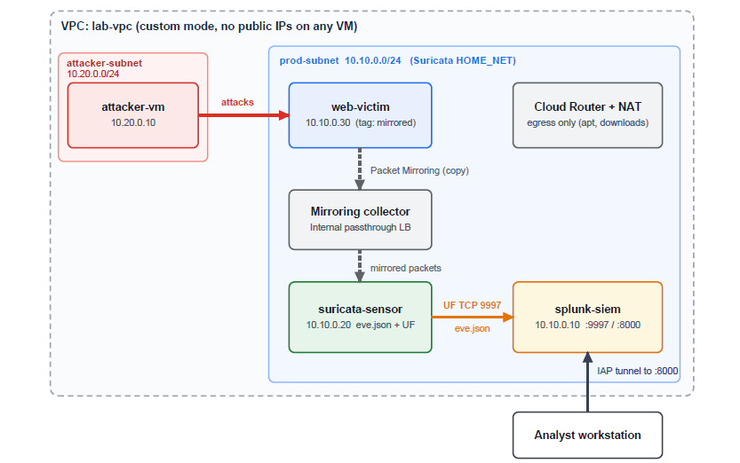

# GCP Network Threat Detection & SIEM Lab

Detect attacks on a Google Cloud network with **Suricata**, send the alerts to **Splunk**, and investigate them like a SOC analyst.

> All attacks were simulated inside my own isolated GCP project.

---

## Quick Navigation

- [What This Project Does](#what-this-project-does)
- [Architecture](#architecture)
- [Tech Stack](#tech-stack)
- [Detections](#detections)
- [Screenshots](#screenshots)
- [Key Lessons](#key-lessons)
- [Repository Structure](#repository-structure)
- [How to Reproduce](#how-to-reproduce)
- [Cost and Cleanup](#cost-and-cleanup)

---

## What This Project Does

1. A web server in a GCP VPC is attacked from another VM.
2. **VPC Packet Mirroring** sends a copy of the server's traffic to a Suricata sensor.
3. Suricata raises alerts using community rules and six custom rules.
4. A Splunk Universal Forwarder ships the events to Splunk.
5. I search, build a dashboard, and write an incident report.

**Goal:** show the full loop of *collect, detect, centralize, investigate*.

---

## Architecture



| Component | Role |
|---|---|
| `attacker-vm` | Runs the simulated attacks (10.20.0.10) |
| `web-victim` | Apache server being attacked (10.10.0.30) |
| `suricata-sensor` | Reads mirrored traffic and detects threats (10.10.0.20) |
| `splunk-siem` | Stores, searches and alerts on events (10.10.0.10) |

**Design choices**
- No public IPs. Access is through IAP only.
- Attacker and victim are in separate subnets, like real internet traffic.
- Packet Mirroring keeps the sensor off the protected server.

---

## Tech Stack

| Area | Tools |
|---|---|
| Cloud | GCP Compute Engine, VPC, Packet Mirroring, Cloud NAT, IAP |
| IDS | Suricata 8 with ET Open rules |
| SIEM | Splunk Enterprise, Universal Forwarder |
| Attack tools | nmap, hydra, nikto, curl |
| Framework | MITRE ATT&CK |

---

## Detections

Six custom Suricata rules, all tested and verified in Splunk.

| Attack | Rule (SID) | ATT&CK |
|---|---|---|
| ICMP burst | LAB Excessive ICMP Echo Requests (9000006) | T1595 |
| Port scan | LAB Possible TCP SYN Port Scan (9000001) | T1046 |
| SSH brute force | LAB SSH Brute Force Attempt (9000002) | T1110 |
| SQL injection | LAB SQL Injection Attempt (9000003) | T1190 |
| Path traversal | LAB Path Traversal Attempt (9000004) | T1190 |
| Nikto scanner | LAB Nikto Scanner User-Agent (9000005) | T1595.002 |

Rules are in [`suricata/local.rules`](suricata/local.rules).

---

## Screenshots

### 1. Architecture

*The full design: attack traffic is mirrored to Suricata, and events flow to Splunk.*

### 2. Packet Mirroring works

*Mirroring policy, healthy collector, and `tcpdump` on the sensor showing traffic between two other hosts.*

### 3. Suricata is running

*Engine started with 2 rule files and 53,400 rules loaded, including the custom rules.*

### 4. All six detections fired

*Splunk search showing alerts 9000001 to 9000006 from the attacker.*

### 5. Attack timeline

*Each attack appears as its own burst on the timeline.*

### 6. Investigation

*Pivoting from the SSH brute-force alert to flow and HTTP events from the same source.*

### 7. Dashboard

*"Network Threat Overview": alerts over time, top sources, severity, targeted ports.*

### 8. Tuning a false positive

*Google health-check traffic triggered the SSH rules. Before and after the fix.*

---

## Key Lessons

**1. A rule can look right and still miss the attack.**
My path traversal rule did not fire. Suricata's normal URI buffer removes `../` before matching. Switching to `http.uri.raw` fixed it.

**2. Cloud infrastructure creates its own noise.**
Google load balancer health checks probe port 22 constantly and tripped my SSH rules. I excluded those ranges.

**3. Network data has limits.**
Suricata cannot see inside encrypted SSH, so it cannot show whether a brute force succeeded. Host logs (`auth.log`) are needed to confirm.

**4. One bad config line stops the whole engine.**
A mistake in `threshold.config` made Suricata fail to load signatures. Always run `suricata -T` before restarting.

---

## Repository Structure

```
.
├── README.md
├── architecture/
│   └── architecture.png
├── gcp/
│   ├── 01-network.sh
│   ├── 02-compute.sh
│   ├── 03-packet-mirroring.sh
│   └── teardown.sh
├── suricata/
│   ├── local.rules
│   └── threshold.config
├── splunk/
│   ├── props.conf
│   ├── inputs.conf
│   └── saved-searches.md
├── attacks/
│   └── scenarios.md
├── reports/
│   └── IR-2026-001.pdf
└── screenshots/
```

---

## How to Reproduce

1. Create a GCP project and enable billing.
2. Run the scripts in `gcp/` to build the VPC, VMs and Packet Mirroring.
3. Install Splunk Enterprise, then Suricata and the Universal Forwarder on the sensor.
4. Copy the files from `suricata/` and `splunk/` into place.
5. Run the attacks in `attacks/scenarios.md` and review the alerts in Splunk.

**Full step-by-step guide:** [`docs/implementation-guide.pdf`](docs/implementation-guide.pdf)

---

## Cost and Cleanup

- Four small VMs, Cloud NAT, a load balancer and Packet Mirroring all cost money.
- Stop the VMs when not in use.
- When finished, delete the whole project: `gcloud projects delete <PROJECT_ID>`

---

## Safety

Run attacks **only** against systems you own, inside your own project. Never reuse the weak SSH password setup outside a lab.

---

## About

**Edson Encinas** | Cloud Security / SOC Analyst
[LinkedIn](https://linkedin.com/in/your-profile) | [Email](mailto:your-email@example.com)
